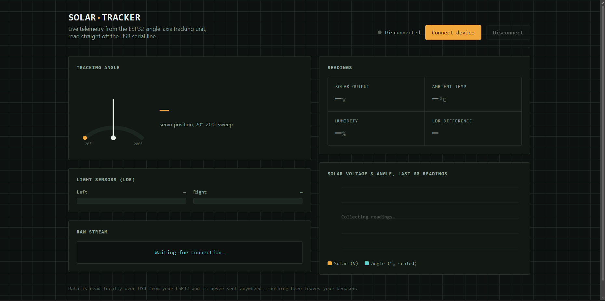

# Solar Tracking & Efficiency Monitoring System

An ESP32-based autonomous single-axis solar tracking system designed to improve solar panel alignment with sunlight while monitoring electrical output and surrounding environmental conditions.

## Project Overview

The Solar Tracking & Efficiency Monitoring System combines embedded hardware and a web-based monitoring dashboard to demonstrate automated solar tracking and real-time data visualization.

Two Light Dependent Resistors (LDRs) detect differences in light intensity. Based on these readings, an ESP32 controls a servo motor to adjust the solar panel's position towards the stronger light source.

The system also monitors solar panel voltage, ambient temperature, and humidity. These readings are transmitted through USB serial communication and displayed on a web-based dashboard.

## Key Features

- **Automatic Sun Tracking:** Uses two LDR sensors to detect light intensity differences and adjust panel orientation.
- **Servo Motor Control:** Controls the panel's single-axis movement using an ESP32.
- **Solar Voltage Monitoring:** Measures the solar panel's output voltage using a voltage divider.
- **Temperature Monitoring:** Uses a DHT11 sensor to measure ambient temperature.
- **Humidity Monitoring:** Measures surrounding humidity using the DHT11 sensor.
- **Live Web Dashboard:** Displays tracking angle, sensor readings, and solar voltage.
- **Graphical Visualization:** Plots solar voltage and tracking angle over time.
- **USB Serial Communication:** Transfers readings directly from the ESP32 to the dashboard.

## Hardware Components

| Component | Purpose |
|---|---|
| ESP32 Development Board | Main controller |
| Solar Panel | Converts sunlight into electrical energy |
| 2 × LDR Sensors | Detect differences in light intensity |
| Servo Motor | Adjusts solar panel orientation |
| DHT11 Sensor | Measures temperature and humidity |
| 10kΩ Resistors | Used in the voltage divider and sensor circuits |
| Jumper Wires | Electrical connections |
| Breadboard | Circuit assembly |

## Pin Configuration

| Component | ESP32 GPIO |
|---|---:|
| Servo Motor | GPIO 18 |
| DHT11 Data | GPIO 16 |
| Left LDR | GPIO 4 |
| Right LDR | GPIO 35 |
| Solar Voltage Sensor | GPIO 32 |

## Software and Technologies

- **Arduino IDE** – ESP32 firmware development
- **C/C++** – Embedded programming
- **ESP32Servo Library** – Servo motor control
- **DHT Sensor Library** – Temperature and humidity readings
- **HTML, CSS and JavaScript** – Web dashboard development
- **Web Serial API** – USB serial communication between the ESP32 and browser

## Working Principle

### 1. Light Detection

Two LDR sensors are positioned to detect sunlight from different directions. Their analog readings are continuously compared to calculate the difference in light intensity.

### 2. Automatic Tracking

When the difference between the LDR readings exceeds a predefined threshold, the ESP32 adjusts the servo motor position in small steps.

This allows the solar panel to gradually align itself towards the direction receiving stronger light.

### 3. Solar Voltage Monitoring

The solar panel voltage is measured through a voltage divider connected to the ESP32 analog input. The controller converts the analog reading into an estimated voltage value.

### 4. Environmental Monitoring

A DHT11 sensor periodically measures ambient temperature and humidity. These readings are collected along with the tracking and voltage data.

### 5. Web-Based Monitoring

The ESP32 sends sensor readings through its USB serial connection. The web dashboard reads the serial data and presents it through numerical indicators, a tracking-angle visualization, sensor bars, and graphical plots.

## Web Dashboard

The project includes a dedicated web dashboard for monitoring the system.

### Dashboard Features

- Live device connection status
- Tracking angle visualization
- Solar panel voltage display
- Ambient temperature and humidity readings
- Left and right LDR readings
- Solar voltage and tracking angle graphs
- Raw serial data display

The dashboard is designed to read data locally through USB serial communication.

## Project Structure

```text
solar-tracking-efficiency-monitor/
│
├── firmware/
│   └── solar_tracker.ino
│
├── dashboard/
│   └── solar-tracker.html
│
├── docs/
│   └── solar-circuit-diagram.docx
│
├── images/
│   └── project-poster.png
│
└── README.md
```

## Applications

- Solar energy harvesting systems
- Renewable energy demonstrations
- Educational electronics and IoT projects
- Automated solar panel positioning
- Solar energy monitoring and experimentation

## Future Improvements

- Integration of wireless monitoring using Wi-Fi.
- Cloud-based data storage and remote monitoring.
- Addition of current sensors for power and energy calculations.
- Implementation of dual-axis solar tracking.
- Historical performance analysis and data logging.

## Project Objective

The primary objective of this project is to demonstrate how embedded systems and automated control can be used to improve solar panel alignment while providing a convenient way to monitor electrical and environmental parameters.

---

**Project Category:** Embedded Systems | Renewable Energy | IoT | Web Development

**Controller:** ESP32

**Monitoring Interface:** HTML, CSS and JavaScript Web Dashboard

## Project Gallery

### Live Monitoring Dashboard



### Circuit Diagram


### Project Poster


